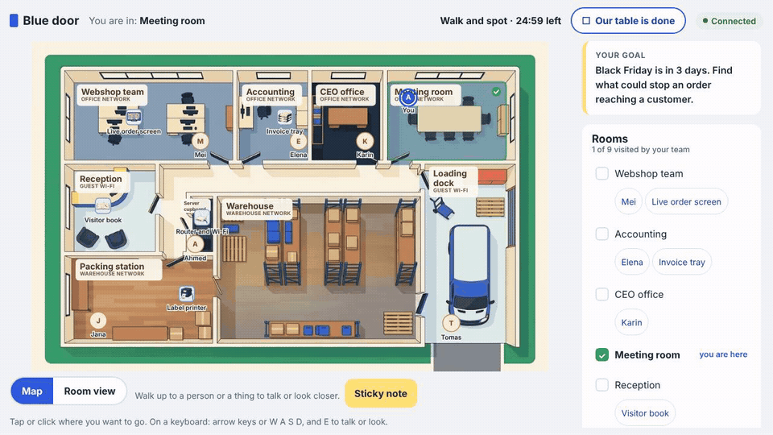

# Open Door

**Walk the office, spot the risks. A free classroom game that teaches threat modelling.**



## What it is

Open Door is a game students play in their browser, in teams, during one class. Each team walks around a made-up company called Nordknit, a family clothing business in Denmark, and talks to the people who work there. They look closer at things like a label printer, a visitor book and the Wi-Fi router, and stick a note wherever they think something could go wrong. Then the day of a real incident plays out: the webshop stops on Black Friday, or a fake e-mail changes the bank details. Each team decides what the CEO should do, and the teacher shows on the big screen which team saw it coming.

Nobody needs an account. Students scan a code on the projector and play on phones or laptops. The teacher runs the class from one page, sees which teams are stuck, can send a hint, and closes the session at the end, which deletes everything. Teams download their notes as a filled-in threat table to take home.

The game follows the CyPro method from the [Digital Business Development toolbox](https://dbd.au.dk/p/toolbox) at Aarhus University: students practise finding assets and threats first, and learn the method's names in the debrief. It is built for the MSc in Engineering, Technology-Based Business Development, in Herning, and is open source.

## Try it

The game is live at <https://open-door.aubtech.workers.dev/>. A teacher opens `/teacher` on that address, creates a session and shows the code on the projector; students join from the link or the QR code.

To run it on your own computer instead, you need [Node.js 22](https://nodejs.org) or newer. In a terminal:

```
npm install
npm run dev
```

Then open `http://localhost:5173/dev`. That page starts a class by itself and shows the teacher, the projector and three students side by side, so you can play every role in one window. For a real class, the teacher opens `/teacher`, students open the join link, and the projector shows `/screen/CODE`. Other devices on the same network join through your computer's address. More about running, testing and publishing is in [docs/developing.md](docs/developing.md).

## How a class plays

A class is 45 or 90 minutes. Students join and sit at a team table, the CEO tells the story, and the teams walk and write notes. Then the incident unfolds with a clock, messages and clues, each team votes on what to do, and the class talks it through with the answer key on the projector.

| Step | 45 min | 90 min | What happens |
|---|---|---|---|
| Join | 5 | 5 | Scan the code, choose a nickname and a face, sit at a team table |
| The story | 3 | 5 | The CEO explains what is at stake |
| Walk and spot | 12 | 25 | Walk the company, talk to people, look closer, write sticky notes |
| The day happens | 15 | 30 | The incident unfolds; teams follow clues and merge notes |
| The vote | 3 | 5 | Each team decides what the CEO should do right now |
| Talk it through | 7 | 20 | The projector compares the teams and reveals the CyPro terms |

## Status

Version 0.x, playable from start to finish, with two scenarios: *Black Friday* and *New bank details*. It has been tested with simulated classes and in real browsers at six screen sizes from phone to projector. Still to do is a classroom test on eduroam, a pilot class and a hallway test with real users. The details are in [next steps](docs/dev-notes/next-steps.md).

## What is in this repository

| Path | What it is |
|---|---|
| [`docs/teaching/`](docs/teaching/) | For teachers: the [facilitator guide](docs/teaching/facilitator-guide.md), the [pilot plan](docs/teaching/pilot-plan.md) and [printable paper kits](docs/teaching/paper-kit/) for when the network fails |
| [`scenarios/`](scenarios/) | The game content as plain text files, and [how to write a new scenario](docs/scenario-format.md) without coding |
| [`docs/concept-book/`](docs/concept-book/index.html) | The concept book: target group, journey, core loop, design system and mockups |
| [`docs/design-system.md`](docs/design-system.md) | Colours, spacing, type and layout rules the screens follow |
| [`docs/decisions/`](docs/decisions/) | Short records of the main decisions and why they were made |
| [`docs/roadmap.md`](docs/roadmap.md), [`docs/backlog.md`](docs/backlog.md) | Where the project is going |
| `app/`, `room/`, `shared/` | The code: the browser app, the Cloudflare Worker that hosts live sessions, and the rules and messages both share |

The documentation site is published at <https://lauphilip.github.io/au-btech-open-door/>.

## Licence

The **code** is released under the [MIT licence](LICENSE). The **content** (scenarios, texts, illustrations and the concept book) is released under [Creative Commons Attribution-ShareAlike 4.0](LICENSE-CONTENT.md), because it builds on CyPro material published under the same licence. See [decision 0002](docs/decisions/0002-licensing.md).

## Credits

The learning content builds on the CyPro project, "Cybersecure manufacturing in Denmark", by Aarhus University, the Alexandra Institute, DAMRC, UGLA Insights and FORCE Technology, funded by the Danish Industry Foundation. All companies, people and incidents in the scenarios are fictional. Nordknit is inspired by family-owned textile businesses in the Herning area and does not describe any real company's security.
